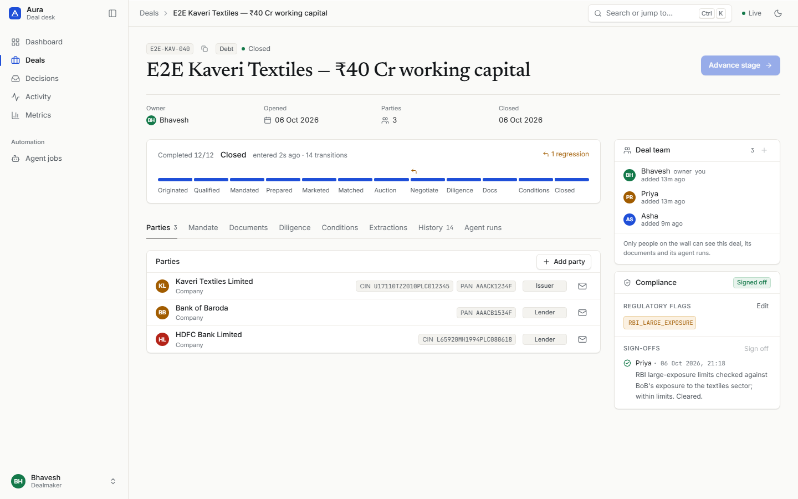
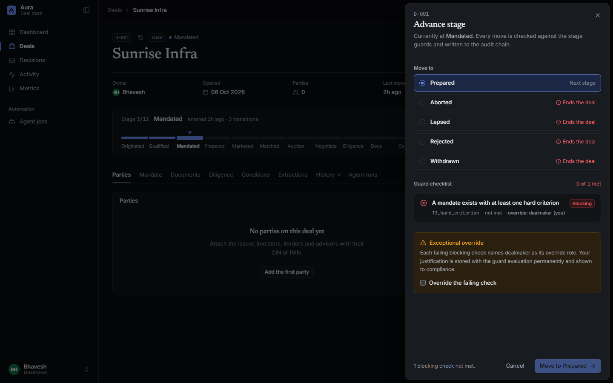
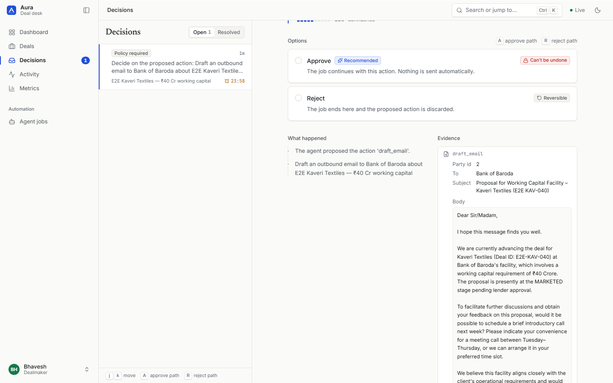
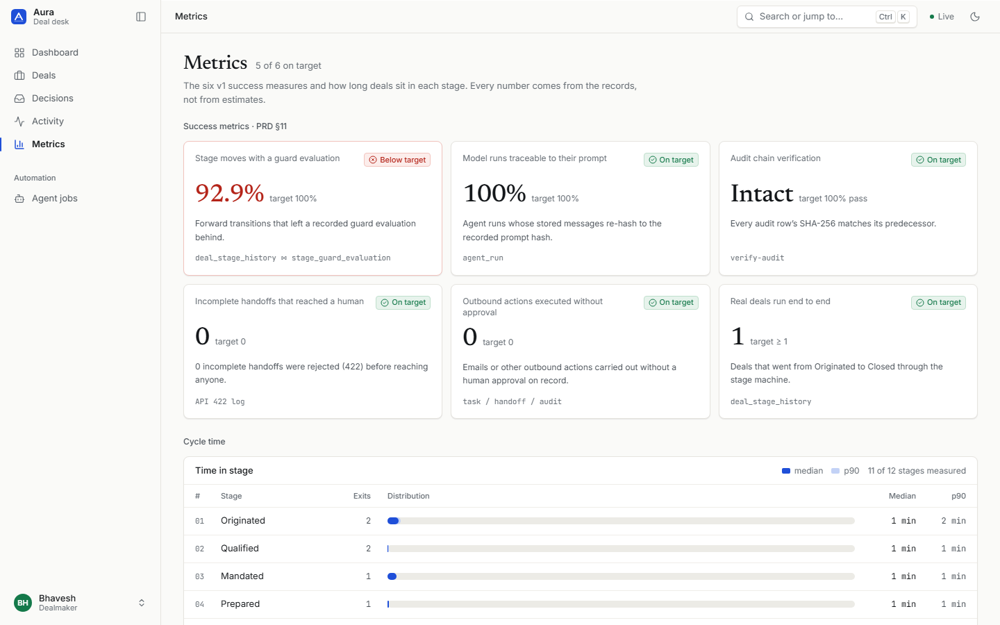

# Aura

A deal-execution workspace for Indian dealmakers. Aura runs a transaction through twelve guarded stages, from first contact to close. Local AI agents do the standardisable work, and every judgement call is handed to a named human.

Everything runs on your machine: local model, local database, no cloud services, no API keys.



## What it does

- **Twelve-stage deal spine.** Each deal moves through the stages ORIGINATED, QUALIFIED, MANDATED, PREPARED, MARKETED, MATCHED, BID/AUCTION, NEGOTIATION, DILIGENCE, DOCUMENTATION, CONDITIONS PRECEDENT and CLOSED. It can also end as LAPSED, WITHDRAWN, REJECTED or ABORTED. Permitted backward moves need a reason code. History is append-only, so cycle time is measured from it alone.
- **Guards as data.** Every forward move is checked against rules stored as database rows, so adding a rule needs no release. Examples: an executed engagement letter, a mandate with a hard criterion, no open diligence blockers, a compliance sign-off on flagged deals. Each check records its result, pass or fail. Only the role a guard names can override it, and only with a written justification.
- **Agents that hand over decisions, not piles of context.** CrewAI agents on a local Ollama model classify documents, extract financials and draft outbound emails. Anything touching money, legal documents or outbound contact, and anything above the materiality cap, becomes a *handoff*. A handoff carries a closed question, options with consequences, a recommendation, and "if you do nothing". Nothing is ever sent automatically.
- **Every model call recorded.** Model, prompt template, prompt hash, input, output, tokens and latency. If a run can't be recorded, its output is not used.
- **Tamper-evident audit.** Every change is written to a SHA-256 hash chain plus a local anchor file, so editing or deleting history is detected.
- **Deal walls.** Only members of a deal's team can see it, its documents or its agent runs, admins included. Everyone else gets "not found".
- **Diligence and documents.** Checklists come from templates, and blockers need evidence before they clear. Findings carry ₹ impact. Documents have versions, sensitivity tiers (UPSI is forced to tier 4), an access log and an executed flag. Extractions that feed valuation need confidence of 0.95 or a human sign-off.

| Advance stage: guard checklist | Decisions inbox | Metrics |
|---|---|---|
|  |  |  |

## Tech stack

| Layer | Choice |
|---|---|
| Backend | Python 3.13, FastAPI, SQLAlchemy 2, SQLite, Alembic, uv |
| Architecture | Hexagonal: `core/` (domain, policy, services) imports nothing from the outer layers; enforced by `lint-imports` |
| Agents | CrewAI, local Ollama `qwen3.5:4b`, first-party MCP deals server; a deterministic stub runs when Ollama is down |
| Frontend | Next.js, TypeScript, Radix primitives, lucide icons, self-hosted Inter / Newsreader / JetBrains Mono |
| Design | "Ledger" design system: light-first warm neutrals and dark theme, WCAG AA in both, ⌘K palette, keyboard-first |

## Quick start

Prerequisites: Python 3.13, [uv](https://docs.astral.sh/uv/), Node 18+, [Ollama](https://ollama.com).

```bash
ollama pull qwen3.5:4b

# Backend — migrates and seeds the database on first start
cd backend
uv sync
uv run uvicorn aura.api.main:app --reload --port 8000

# Frontend — in a second terminal
cd frontend
npm install
npm run dev
```

Open <http://localhost:3000>. The backend log should say `Orchestrator: CrewAI on http://localhost:11434`. If it says `StubOrchestrator`, Ollama isn't running: the app still works, but agents return canned output.

Optional: `uv run python -m aura.data.demo` (backend stopped) fills the portal with 17 fictional, fully guarded and audited demo deals plus five more logins, and `uv run python -m aura.data.live_demo` drives a fresh deal through the spine in real time while you watch the portal. See [RUNNING.md](RUNNING.md#demo-data-optional).

### Seeded logins

| User | Password | Role | Can |
|---|---|---|---|
| `bhavesh` | `admin123` | Dealmaker | Move deals, decide handoffs, plus all analyst work |
| `asha` | `analyst123` | Analyst | Upload documents, work diligence, add parties and mandates, run agents |
| `priya` | `compliance123` | Compliance | Manage deal teams, sign off flagged deals, override compliance guards |
| `admin` | `admin123` | Admin | Manage users only — no deal access |

These are development credentials. Change them, and `AURA_JWT_SECRET` in `backend/.env`, before anyone else uses the app.

## Checks

```bash
cd backend
uv run pytest tests -q                       # full suite
uv run lint-imports --config .importlinter   # layering rule
uv run alembic check                         # models and migrations agree
uv run python -m aura.data.verify_audit      # audit hash chain + anchor

cd ../frontend
npm run build                                # must pass with no type errors
```

## Project layout

```
Aura/
├── backend/
│   ├── src/aura/
│   │   ├── core/        # domain, policies (stages, gates, roles), services, ports — no framework imports
│   │   ├── data/        # SQLAlchemy tables, repositories, unit of work, seed, audit verification
│   │   ├── api/         # FastAPI routers, schemas, WebSocket hub
│   │   ├── agents/      # CrewAI crews, recording LLM, gated tools
│   │   ├── mcp/         # first-party deals MCP server
│   │   └── worker/      # background job runner
│   ├── migrations/      # Alembic revisions
│   └── tests/           # unit + integration
├── frontend/
│   ├── app/             # Next.js routes: dashboard, deals, decisions, activity, metrics, admin
│   ├── features/        # per-feature API, hooks, components
│   └── shared/          # design system, shell, API client
└── docs/
    ├── PRD-v1.md               # product requirements for this release
    ├── PRD-v1-conformance.md   # every PRD requirement mapped to code, tests and UI
    └── screenshots/
```

## Documentation

- [RUNNING.md](RUNNING.md) — full operating guide: setup, roles and permissions, API reference, agents, migrations, troubleshooting.
- [docs/PRD-v1.md](docs/PRD-v1.md) — what v1 builds and why, scoped from the SOSPE master specification.
- [docs/PRD-v1-conformance.md](docs/PRD-v1-conformance.md) — requirement-by-requirement status, plus the end-to-end run log.

## Status and limitations

v1 meets PRD-v1: 123 of 128 requirements are done and 5 are partial. One demo deal has been run from ORIGINATED to CLOSED through the UI with live agents.

- **Single machine.** SQLite and a single worker. Deal walls are enforced in the application layer. Postgres with row-level security is the planned upgrade, needed before multiple concurrent users or real unpublished price-sensitive information (UPSI).
- **Small local model.** `qwen3.5:4b` on CPU takes 30 seconds to 3 minutes per agent step and won't always produce a clean tool call. Every agent decision goes to a human, so a weak model costs speed, not correctness.
- **Not production-hardened.** Development secrets and seeded passwords. The audit anchor is a local file, not write-once storage.
- **Out of scope for v1:** matching, auctions, outbound channels, ledgers. See PRD-v1 §7.
