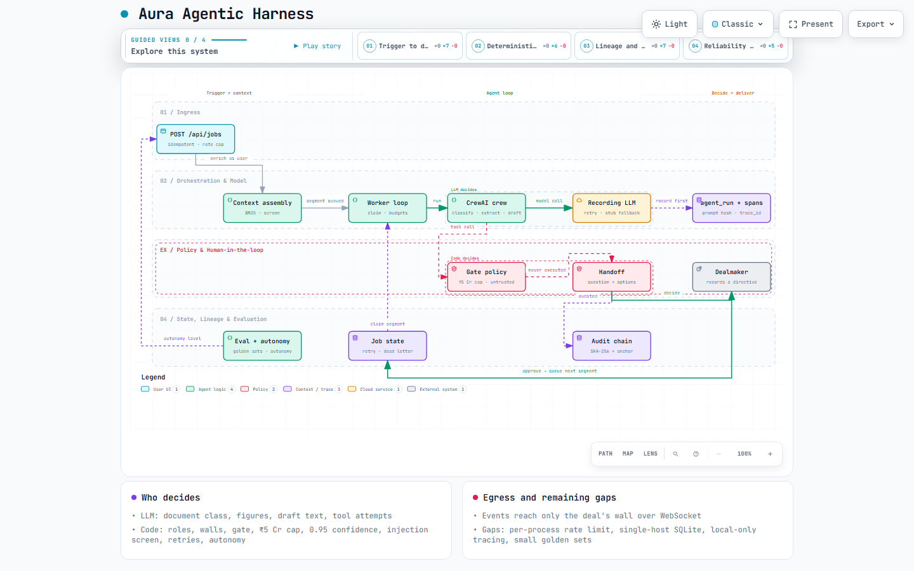

# Aura — Agentic Harness Architecture

**Date:** 2026-10-07 · **Diagram:** [architecture/agentic-harness.html](architecture/agentic-harness.html). It is an interactive standalone page with light/dark themes, guided views and export; the source is [architecture/agentic-harness.workflow.json](architecture/agentic-harness.workflow.json).

An **agentic harness** is everything around the model that turns it into a reliable agent: trigger, context, loop, model access, tools, policy, human approval, state, telemetry, evaluation, isolation, recovery and delivery. This document does three things:
1. Defines the standard harness categories, from industry sources.
2. Maps every micro-step of Aura's agent loop to those categories, with code references.
3. Scores Aura's coverage, lists what has been implemented since the first trace, and lists what is still missing.

It was first written before two harness phases landed (reliability and state, then evaluation, security, observability and context). Every micro-step and line reference below was re-traced against the code after both. Operational detail (settings, endpoints, commands) is in [RUNNING.md](../RUNNING.md), sections "Retries, dead letters and recovery" and "Evaluation, autonomy and safety".

Paths are relative to `backend/src/aura/` unless noted. Frontend surfaces are named by feature folder under `frontend/features/`.

---

## 1. The 13 harness categories

Synthesised from Anthropic's [Building effective agents](https://www.anthropic.com/research/building-effective-agents) and [context engineering](https://www.anthropic.com/engineering/effective-context-engineering-for-ai-agents) posts, LangGraph's [human-in-the-loop](https://docs.langchain.com/oss/python/langgraph/human-in-the-loop) and [persistence](https://docs.langchain.com/oss/python/langgraph/persistence) docs, [CrewAI tasks](https://docs.crewai.com/en/concepts/tasks), the MCP primitives, [NeMo Guardrails](https://docs.nvidia.com/nemo/guardrails/0.19.0/user-guides/guardrails-process.html), [OpenTelemetry GenAI agent spans](https://opentelemetry.io/docs/specs/semconv/gen-ai/gen-ai-agent-spans), and 12-factor agents. These came from search summaries; read the primary pages before relying on fine detail.

| # | Category | What it covers |
|---|---|---|
| 1 | Trigger / Ingress | Starting a run: authenticate, authorise, normalise, deduplicate, assign a run ID |
| 2 | Context assembly | Building what the model sees: template, state, retrieval, tool specs, compaction |
| 3 | Planning / Orchestration | Control flow: single loop, workflow pattern or multi-agent; termination |
| 4 | Model access | Calling the model reliably: routing, retries, failover, structured output and repair, tokens and cost |
| 5 | Tools & actions | Tool schemas, argument validation, execution, MCP, result normalisation |
| 6 | Policy & guardrails | Input and output checks, authorisation before a tool runs, materiality, permissions |
| 7 | Human-in-the-loop | Interrupt, checkpoint, notify, decide, resume |
| 8 | State & memory | Run state, checkpoints, durable records, long-term memory |
| 9 | Observability & lineage | Traces and spans, prompt and version logging, tokens, cost, latency |
| 10 | Evaluation & feedback | Golden sets, offline and online evals, override rates, promotion and demotion |
| 11 | Security & isolation | Data scoping, least privilege, secrets, sandboxing, prompt-injection defence |
| 12 | Error handling & recovery | Retries, fallbacks, dead letters, idempotency, resume after a crash |
| 13 | Delivery / Egress | Results, events, notifications, audit log |

---

## 2. Aura's micro-steps by category

Legend: **[LLM]** = the model decides · **[Code]** = deterministic code decides.

### 1. Trigger / Ingress
1. `POST /api/jobs` takes an optional `Idempotency-Key` header and returns 202 (200 with `Idempotent-Replayed: true` on a replay). The request runs in one unit of work, with every repository built for the requesting user (`api/routers/jobs.py:49-73`, `api/deps.py:33-44, 86-95`).
2. **[Code]** Per-user rate limit: a token bucket of `AURA_JOB_SUBMITS_PER_MINUTE`; over it the answer is 429 with `Retry-After` (`api/routers/jobs.py:64`, `api/rate_limit.py:23-28`, `core/policy/rate_limit.py:8-30`, handler `api/errors.py:30-35`). It lives in process memory.
3. **[Code]** Idempotency: same key and same body within 24 hours returns the original job; same key, different body is 409. Keys are per user and unique on `(key, username)` (`core/services/submit_job.py:132-173`, `data/repositories/sql.py:373-408`, `data/models/tables.py:124-127`).
4. **[Code]** Role check: only dealmaker and analyst may submit (`submit_job.py:83`, `core/policy/rbac_policy.py:27-34`).
5. **[Code]** Wall check: a deal the user can't see returns 404 (`submit_job.py:97-100`).
6. **[Code]** The capability must be `classify_document`, `draft_email` or `extract_financials`, otherwise 422 (`submit_job.py:24, 104-106`).
7. **[Code]** Autonomy level check at submit: a capability at level 0 is refused with 409 naming the reason (`submit_job.py:107`, `core/services/autonomy.py:44-51`).
8. The job (with `trace_id`/`span_id` of the `job.submit` span) is written as PENDING and segment 1 as QUEUED; then come an audit row and a `job_submitted` event (`submit_job.py:84-90, 110-122`).

### 2. Context assembly
9. **[Code]** Enrichment at submit time, as the user: the subject document, or the party link (`submit_job.py:30-58`).
10. **[Code]** `assemble_context` re-reads the subject document through the job user's wall-scoped repositories; a document that is gone or no longer visible raises NotFound (`core/services/context_assembly.py:87-109`).
11. **[Code]** Retrieval for `classify_document` and `draft_email`: the deal's other documents are chunked (600 characters, 100 overlap) and ranked with BM25, standard library only, deterministic ties (`context_assembly.py:110-120`, `core/services/retrieval.py:31-62`). The top `AURA_RETRIEVAL_TOP_K` chunks ride along with `citations`.
12. **[Code]** Every piece of document text is screened and wrapped as untrusted data before it enters the context (`context_assembly.py:41-84`, `core/policy/injection_policy.py:88-117`).
13. **[Code]** Budget and compaction: the block is capped at `AURA_MAX_CONTEXT_CHARS`; the least relevant chunks are dropped first, then the excerpt is truncated; `context_budget` records what went (`context_assembly.py:54-83`).
14. **[Code]** Re-assembly at run time: the worker rebuilds the context as the job's user (not SYSTEM) before each segment, so new document versions and wall changes apply (`worker/runner.py:143-149`, `core/services/run_segment.py:185-186`).
15. A `RunContext` is built with job, deal, acting username, segment id, the run-record sink and the screening summary as notes (`run_segment.py:188-193`, `core/ports/orchestrator.py:31-43`).
16. **[Code]** `acting_as(username)` makes the MCP tools read through the user's walls when they run (`mcp/identity.py:17-22`, `agents/crewai/orchestrator.py:179`, `agents/crewai/tools.py:86`).
17. Each role's prompt is a versioned file in the registry, pinned by SHA-256 in `manifest.json`; a test fails when a file changes without a version bump (`agents/prompts/__init__.py:24, 86-111`, `agents/crewai/crews.py:12-27`). `classify_document@v2` is active.

### 3. Planning / Orchestration
18. **[Code]** The orchestrator is chosen per segment, not once at startup: the crew while Ollama answers (health trusted for `AURA_ORCHESTRATOR_HEALTH_TTL_SECONDS`), otherwise the stub, audited as `orchestrator_fallback` (`agents/factory.py:51-101`, `worker/runner.py:133-141`, `api/main.py:65-70`). The worker invalidates the check after a transient failure (`runner.py:170-171`).
19. **[Code]** The worker thread loops: autonomy sweep (hourly), escalation sweep, stale-segment sweep, then one claim; it sleeps 2 seconds when idle (`worker/runner.py:237-267`).
20. **[Code]** Daily budget: if `AURA_MAX_LLM_CALLS_PER_DAY` agent runs exist since 00:00 UTC, the freshly claimed segment is deferred to the next UTC day (`runner.py:124-131`, `core/services/segment_reliability.py:130-145`).
21. **[Code]** The segment and job are marked RUNNING and committed (`run_segment.py:171-176`).
22. **[Code]** Autonomy level check inside the segment: level 0 fails a first segment with `CapabilityDisabled`; later segments of an already-approved job still finish (`run_segment.py:182-184`).
23. **[Code]** Resume short-circuit: a context carrying `resume_after_approval`, `sent` or `proposal_made` completes without a model call (`agents/crewai/orchestrator.py:165-172`; stub: `worker/stub_orchestrator.py:125-128`).
24. **[Code]** Dispatch by capability (`orchestrator.py:178-186`).
    - Classify and extract use one agent with no tools (`crews.py:30-44`).
    - Draft email uses a sequential Researcher → Drafter → Reviewer crew, with memory off (`crews.py:47-64`, `orchestrator.py:260-293`).
25. **[Code]** Per-segment budgets: at most `AURA_MAX_LLM_CALLS_PER_SEGMENT` model calls and `AURA_MAX_SEGMENT_SECONDS`; going over raises `BudgetExceeded`, which is permanent (`agents/llm/recording.py:112-120`, `core/policy/retry_policy.py:33`).

### 4. Model access
26. `crewai.LLM("ollama/<model>")`; the model version is the Ollama digest, read once per orchestrator instance (`orchestrator.py:146-163`, `agents/llm/ollama_check.py:20`).
27. Every `call()` goes through a recording wrapper (`agents/crewai/recording_llm.py:20-43`).
28. **[Code]** Concurrency: at most `AURA_MAX_CONCURRENT_LLM_CALLS` calls at once per process, a re-entrant semaphore; waiting longer than the segment budget is a transient error (`recording.py:39-68, 173`).
29. **[Code]** LLM call retries: a transient error (connection refused, timeout, 5xx) is retried up to `AURA_LLM_MAX_RETRIES` with exponential backoff. Every attempt, failed or not, is its own `agent_run` row (`recording.py:162-201`, `core/policy/retry_policy.py:61-73`).
30. **[LLM]** Document class, extracted figures, draft and review text, and confidence.
31. **[Code]** JSON repair: fenced blocks, balanced braces, trailing commas, quotes (`agents/llm/repair.py:20-56`).
32. **[Code]** Parse fallbacks: keep the current class, or null figures, at confidence 0.0 (`orchestrator.py:48-58, 90-100`).

### 5. Tools & actions
33. Four deals-MCP functions are wrapped as `GatedTool`s, with argument schemas taken from the function signatures (`agents/crewai/tools.py:90-119`).
34. **[LLM]** Which tools the agent tries to call.
35. **[Code]** Ungated tools (internal read/write) run as the acting user inside a `tool.call` span (`tools.py:74-87`).
36. **[Code]** Tool output screening: what an ungated tool returns is stripped of hidden characters and screened; output that looks like an injection is wrapped as untrusted data and recorded on the gate (`tools.py:50-55`, `orchestrator.py:125-129`).
37. **[Code]** The standalone stdio MCP server enforces `gate_policy` itself: a gated call answers `requires_human_approval` and never reaches the tool body (`mcp/servers/deals_server.py:40-63`).
38. `add_internal_note` now stores the note (`deal_note`), as the acting user, behind their walls, audited `note_added` (`deals_server.py:85-102`, `core/services/notes.py:12-30`); `GET /api/deals/{id}/notes` lists them.

### 6. Policy & guardrails
39. **[Code]** Gate classification: anything not internal read/write is gated, and so is anything unmapped or above the ₹5 Cr materiality cap (`core/policy/gate_policy.py:30-45`).
40. **[Code]** Gated tool bodies **never execute**; the agent receives a blocked message (`tools.py:83-85`).
41. **[Code]** Approval is re-checked on the proposed action (`run_segment.py:240-241`).
42. **[Code]** Trigger precedence: materiality gate, then confidence below 0.95, then policy required (`run_segment.py:33-40`).
43. **[Code]** Autonomy level 1: a confident extraction also goes to a person, with a note saying why (`run_segment.py:217-222`).
44. **[Code]** Injection screening result: if the assembled context or any tool output scored at or above `AURA_INJECTION_RISK_THRESHOLD`, the result is **forced** into a handoff with trigger `untrusted_content`, even when no approval would otherwise be needed, and an `injection_suspected` audit row is written (`run_segment.py:67-85, 202, 223-238, 256-257`). The `do_not_revisit` shortcut is skipped for it (`run_segment.py:244`); once a person approves, the matched rules are acknowledged so the job finishes instead of asking again (`run_segment.py:81-83, 230-231`).
45. **[Code]** Policy builds the handoff package and picks the recommendation, not the model; for untrusted content it recommends the option that changes nothing and caps confidence at 0.5 (`core/policy/handoff_policy.py:136-200, 133`, `gate_policy.py:48-54`).
46. **[Code]** Evidence in the package: the proposed action, `additional_gated_attempts` (gated tools the crew tried and never ran), and `untrusted_content` (score, rules, sources) (`handoff_policy.py:173-183`, `orchestrator.py:108-113, 207, 288`).
47. **[Code]** Schema validation (`handoff_policy.py:41-97`).
    - A bot-to-human handoff needs `decision_required` (question, 2–5 options, a recommendation among them, confidence), plus `if_you_do_nothing`, `what_happened` and `evidence`.
    - A directive needs reasoning of at least 30 characters, `do_not_revisit`, and `next_checkpoint`.

### 7. Human-in-the-loop
48. The segment and job become AWAITING_APPROVAL (`run_segment.py:242-243, 268`).
49. **[Code]** `do_not_revisit` skip path: if an earlier directive on this deal covers the task type, the earlier decision is applied and audited as `handoff_skipped_per_directive` (`run_segment.py:43-53, 244-254`).
50. Otherwise a task (REVIEW) and handoff (OPEN, `auto_escalate_at` +24h) are created in a `handoff.create` span, with an audit row and event; the segment's model runs are then linked to the task (`core/services/handoffs.py:26-85, 234-242`, `run_segment.py:258-267`, `data/repositories/sql.py:313-318`).
51. The Decisions inbox lists open and escalated handoffs, filtered by wall; untrusted-content handoffs show their evidence and are styled apart (`api/routers/handoffs.py:25-30`; frontend `features/handoffs`, `Evidence.tsx`).
52. **[Code]** Resolve (a `handoff.resolve` span) runs these checks in order (`handoffs.py:143-214, 248-254`):
    - role check;
    - 404 if not found;
    - 409 if already resolved;
    - compliance allowed only for `policy_required`;
    - directive validation (a 422 is audited as `handoff_rejected`);
    - then a conditional `UPDATE ... WHERE status IN (open, escalated)` claims the resolution, so of two concurrent resolves exactly one wins and the other gets 409 (`handoffs.py:183-188`, `data/repositories/sql.py:264-286`).
53. **[Code]** Approve, confirm or verify queues segment n+1 with the first one's `context_out`; anything else rejects the job (`handoffs.py:106-125`).
54. **[Code]** The escalation sweep marks overdue handoffs ESCALATED (`handoffs.py:217-231`).

### 8. State & memory
55. Tables: `jobs`, `segments` (unique on job + seq; with `claimed_by`, `claimed_at`, `attempts`, `not_before`, `last_error`), `task`, `handoff`, `agent_run`, `idempotency_key`, `deal_note`, and the append-only `audit_entries` (`data/models/tables.py:104-127`, `data/triggers.py:2`).
56. **[Code]** Atomic claim: one conditional `UPDATE ... WHERE status='queued' AND not_before <= now ... RETURNING`, committed at once; it stamps the worker, the time and counts an attempt (`data/repositories/sql.py:109-144`, `worker/runner.py:104-112`).
57. **[Code]** Lease and recovery: a RUNNING segment whose claim is older than `AURA_SEGMENT_LEASE_SECONDS` is requeued, or dead-lettered when out of attempts, by a sweep that runs at startup and before every claim (`segment_reliability.py:94-119`, `worker/runner.py:194-208, 254`, `data/repositories/sql.py:146-157`).
58. **[Code]** Stale-result discard: before using a result, `hold_claim` confirms the segment is still this worker's claim (same `claimed_by` and attempt count, still RUNNING) and holds the row until commit; otherwise the result is thrown away and `stale_result_discarded` is audited (`run_segment.py:88-107, 195-197, 288-289`, `sql.py:159-176`).
59. Transactions: one per API request; per worker segment a claim commit, a RUNNING commit, then one outcome commit, plus an immediate `agent_run` commit per model call (`data/uow.py:30-60`, `data/run_sink.py:21-28`).
60. There is no long-term agent memory (the crew runs with `memory=False`, by design); continuity comes from the job and segment `context_out` → `context_in`.

### 9. Observability & lineage
61. **[Code]** Each run is written with `prompt_hash` (SHA-256 of the canonical messages), `input_digest` (messages plus screening notes), output, tokens, latency, `prompt_template_id` (`<id>@v<N>`), `trace_id`, `span_id` and `cost_inr=0` (local model). If the record can't be written, the output is **not used** (`agents/llm/recording.py:122-160`, `core/policy/lineage_policy.py:7-16`).
62. Run records commit immediately, so they survive a segment rollback (`data/run_sink.py:21-28`).
63. **[Code]** Local OpenTelemetry-shaped tracer: spans `job.submit` (`submit_job.py:84`), `segment.run` (`run_segment.py:153`), `llm.call` with `gen_ai.*` attributes (`recording.py:133-141`), `tool.call` (`tools.py:76`), `handoff.create` and `handoff.resolve` (`handoffs.py:236, 251`), `eval.run` and `eval.case` (`evals/run.py:98, 166`). One job is one trace; finished spans are buffered and flushed to `trace_span` after commit (`core/tracing.py:63-135`, `data/spans.py:16-35`, `data/uow.py:40-46`). Nothing is exported.
64. `agent_run` rows carry `trace_id`/`span_id` and, once a handoff exists, `task_id` (`run_segment.py:266-267`); audit rows written inside a span carry its trace in their payload, before hashing (`data/repositories/sql.py:341-352`).
65. Hash-chained audit with an anchor file, written under a thread lock (`data/repositories/sql.py:32, 341-359`, `core/domain/audit.py:22-33`, `data/verify_audit.py`; the worker refreshes the anchor every 60 s, `runner.py:229-234`).
66. Metrics: `runs_traceable_pct`, `audit_chain_ok`, `handoff_rejections_422`, `outbound_executed` (`core/services/metrics.py:105-133`), plus `reliability` counted from the audit trail (`metrics.py:31-49`) and `evaluation` and `security` sections (`core/services/harness_metrics.py:29-54`); served by `api/routers/metrics.py:20-44`.
67. API: `GET /api/traces/{trace_id}` (wall-filtered), `GET /api/prompts`, and `trace_id`/`span_id` on agent runs and jobs (`api/routers/harness.py:65-80`, `api/routers/agent_runs.py:11-20`).

### 10. Evaluation & feedback
68. Golden sets are versioned JSONL files in `backend/evals/golden/` (24 classification, 12 extraction, 6 draft cases); each run stores the file's SHA-256.
69. **[Code]** The runner sends each case through the real orchestrator path with the same context composition a job gets, records every call as an `agent_run` (`eval:<role>`), writes an `eval_run` and one `eval_case_result` per case, and exits 1 below threshold (`evals/run.py:72-84, 146-195, 234-275`). `--capability`, `--orchestrator stub|crew`, `--limit` and `--cases ID,ID`.
70. **[Code]** Scoring: classification accuracy, macro-F1 and calibration; extraction per-field tolerance; draft rubric (subject, party named, length, no invented amounts, no commitments) (`core/services/evaluation.py:38-152`).
71. **[Code]** Partial runs (`--limit` or `--cases`) are stored with `metrics.partial = true`; `latest` skips them, so they never count for autonomy (`evals/run.py:161-185`, `data/repositories/sql_harness.py:70-79`).
72. **[Code]** Override rate: over resolved handoffs in 30 days, a person overrode the agent by choosing `keep`, `discard` or `reject` (`evaluation.py:21-27, 154-195`; `GET /api/evals/override-rates`, `harness.py:42-46`).
73. **[Code]** Autonomy levels per capability (2 autonomous, 1 supervised, 0 off). Demotion is automatic, one level at a time, when the latest real-model eval failed or the override rate is above 20% of at least 20 decisions; promotion is admin only, one level, and needs a passing real-model run from the last 7 days (`core/services/autonomy.py:66-120`). The worker applies demotions hourly (`worker/runner.py:211-226, 241-249`) and so does `python -m aura.evals.autonomy [--apply]` (`evals/autonomy.py:21-46`).
74. API: `GET /api/evals/runs`, `GET /api/evals/runs/{id}`, `GET /api/autonomy`, `POST /api/autonomy/{capability}/promote` (`api/routers/harness.py:25-62`).
75. UI: the **Agent quality** page (`/quality`, `frontend/features/quality`) shows eval runs and case detail, override rates, autonomy and the prompt registry; Metrics gains reliability, evaluation and security sections.

### 11. Security & isolation
76. **[Code]** Deal walls bind every repository, including MCP tool reads during agent runs and the context re-assembled at run time. Off-wall data returns 404.
77. **[Code]** Prompt-injection defence in depth: hidden and control characters stripped; named rules score the text; text wrapped between `<<<UNTRUSTED_DATA>>>` markers with a standing instruction; tool output screened the same way; a high score forces a human decision (see steps 12, 36, 44) (`core/policy/injection_policy.py:20-120`).
78. Everything runs locally (Ollama), with telemetry disabled. No data leaves the machine.
79. The worker uses SYSTEM-scoped repositories for its own bookkeeping (`worker/runner.py:117-120`), but the model only sees context re-assembled with repositories built for the job's user (`runner.py:145-149`) and tools run as that user (step 16).

### 12. Error handling & recovery
80. **[Code]** Any exception rolls back (a `HandoffRejected` keeps its audit row), then `handle_segment_failure` classifies it (`run_segment.py:281-291`, `segment_reliability.py:58-91`, `core/policy/retry_policy.py:61-73`).
81. **[Code]** Transient failure: the segment is requeued with exponential backoff (10 s, 20 s, 40 s, via `not_before`), audited `segment_retry_scheduled`; after `AURA_SEGMENT_MAX_ATTEMPTS` it becomes `dead_letter`, the job `failed`, audited `segment_dead_lettered` (`segment_reliability.py:41-79`, `retry_policy.py:36-50`).
82. **[Code]** Permanent failure (validation, a run that could not be recorded, a policy refusal, a used-up budget): the segment fails at once with `last_error`, audited `segment_failed` with `permanent: true` (`segment_reliability.py:81-91`). A failure to write the run record raises `AgentRunLogError`; parse failures lower confidence instead.
83. **[Code]** Manual retry: `POST /api/jobs/{id}/retry` requeues a dead-lettered or failed last segment with a fresh attempt count, audited `segment_retried`; `GET /api/jobs/dead-letter` lists them (`segment_reliability.py:148-187`, `api/routers/jobs.py:82-110`).
84. **[Code]** Job responses expose `attempts`, `phase` (`retrying`, `deferred`, `dead_letter`), `next_attempt_at` and `last_error` from the latest segment (`api/routers/jobs.py:21-46`). UI: the Agent jobs page has a dead-letter section with retry, and phase badges (`frontend/features/jobs`).
85. Errors outside the segment's try block roll back and are logged (`worker/runner.py:173-175, 258-259`).

### 13. Delivery / Egress
86. Every audited mutation emits `entity_changed {kind, deal_id}` after commit (`core/services/notifying_audit.py:13-18`).
87. The WebSocket at `/ws/events` (JWT) delivers deal events **only to members of that deal's wall** and drops them if the wall can't be read (`api/main.py:79-90`, `api/ws/hub.py:47-65`). Reliability events (`job_retrying`, `job_deferred`, `segment_dead_lettered`, `job_failed`) use the same path.
88. The frontend keeps one socket with backoff, refetches on matching events, and polls every 20 seconds when the socket is down (`frontend/shared/api/ws.ts`, `events.tsx`); the Activity feed has verbs for the new audit actions.
89. Nothing is ever sent outbound: `outbound_executed` is never written (`core/services/outbound.py`).

---

## 3. Who decides what

| The model decides | Code decides |
|---|---|
| Proposed document class, its confidence and rationale | Role and permission checks, wall scoping, rate limit, idempotency |
| Extracted figures and confidence | Allowed capabilities, autonomy level, context assembly, retrieval and budget |
| Research, draft and review text | Orchestrator choice per segment, dispatch, resume short-circuit |
| Which tools the agent tries to call | Gate category, materiality cap, 0.95 confidence gate, tool-output screening |
| | Handoff options **and recommendation**, schema validation, forced `untrusted_content` handoff |
| | `do_not_revisit` skip, continue or reject, escalation |
| | Retry, backoff, dead letter, recovery, stale-result discard, budgets |
| | Parse fallbacks, run-record lineage, audit, spans |
| | Eval scoring, override rate, demotion; promotion only by an admin |

This follows the 12-factor principle: the model proposes, and deterministic code owns control flow and every consequential decision.

---

## 4. Coverage scorecard

| # | Category | Aura | Notes |
|---|---|---|---|
| 1 | Trigger / Ingress | ✅ Strong | Role, wall, capability and autonomy checks; `Idempotency-Key`; per-user rate limit. **Gap:** the rate limit is in process memory, so several API processes would each allow the full rate |
| 2 | Context assembly | ✅ Strong | Versioned prompts, context re-assembled as the job's user at submit and at run time, BM25 retrieval with citations, character budget with recorded drops. **Gap:** keyword retrieval only (no embeddings); compaction drops or truncates, it does not summarise |
| 3 | Orchestration | ✅ Strong | Capability dispatch, sequential crew, resume short-circuit, per-segment orchestrator health check with stub fallback, per-segment call and time budgets, daily budget. **Gap:** fixed crews, no planning loop (by design) |
| 4 | Model access | 🟡 Partial | Recording wrapper, JSON repair, safe fallbacks, retries with backoff, concurrency limit. **Gaps:** one model only; `pinned_model` is stored but never used to choose a model; the concurrency semaphore is per process; `cost_inr` is always 0; the fallback is a keyword stub, not a second model |
| 5 | Tools & actions | ✅ Strong | Gated MCP wrappers; the standalone MCP server gates itself; `add_internal_note` persists; tool output screened. **Gap:** only four tools, and `send_email` is deliberately never executable |
| 6 | Policy & guardrails | ✅ Strong | Deterministic gate, materiality, confidence, autonomy level, policy-chosen recommendation, schema validation |
| 7 | Human-in-the-loop | ✅ Strong | Structured handoffs, directives, `do_not_revisit`, escalation, atomic resolve (409 for the loser) |
| 8 | State & memory | 🟡 Partial | Atomic claim, lease recovery, stale-result discard, durable job, segment, task and handoff records. **Gaps:** single-machine SQLite, so no multi-host workers and the audit write lock is per process; no long-term agent memory (by design) |
| 9 | Observability & lineage | ✅ Strong | Run records written before use, hash-chained audit, `gen_ai.*` spans linked to `agent_run` and audit rows, trace viewer, reliability metrics, `agent_run.task_id` linked. **Gaps:** the tracer is local only (no OTLP export); `cost_inr` is 0 |
| 10 | Evaluation & feedback | 🟡 Partial | Golden sets, scoring, override rate, automatic demotion, admin promotion, partial runs excluded. **Gaps:** golden sets are small (24/12/6) and fictional; the stub scores are a keyword baseline, not model quality; evals run without retrieval, and no golden case drives the injection path end to end; real-model runs are manual |
| 11 | Security & isolation | ✅ Strong | Walls bind agent tools and run-time context; local-only; injection screening of documents, retrieved chunks and tool output with a forced human decision. **Gaps:** screening is rule-based (a paraphrased attack can pass); the worker still holds SYSTEM-scoped repositories |
| 12 | Error handling & recovery | ✅ Strong | Transient/permanent split, backoff, dead letters, manual retry, crash recovery, stale-result discard, idempotent submit, LLM call retries |
| 13 | Delivery / Egress | ✅ Strong | Wall-filtered WebSocket, audited events, nothing sent outbound. **Gap:** events with no `deal_id` go to every connected socket (`api/ws/hub.py:49-50`) |

**Totals:** 10 strong · 3 partial · 0 missing. (First trace: 7 strong · 5 partial · 1 missing.)

---

## 5. Implemented since the first trace, and what remains

### Implemented

| Fix | Where in code | Category |
|---|---|---|
| Atomic segment claim (conditional `UPDATE ... RETURNING`) | `data/repositories/sql.py:109-144` | 8, 12 |
| Lease, startup and pre-claim recovery of stale RUNNING segments | `segment_reliability.py:94-119`, `worker/runner.py:194-208` | 8, 12 |
| Stale-result discard (`hold_claim`, `stale_result_discarded`) | `run_segment.py:88-107`, `sql.py:159-176` | 8, 12 |
| Transient/permanent retry policy, backoff, dead letters, manual retry | `core/policy/retry_policy.py`, `segment_reliability.py:41-187`, `api/routers/jobs.py` | 12 |
| LLM call retries, per-segment budgets, concurrency semaphore | `agents/llm/recording.py:39-68, 112-120, 162-201` | 4, 3 |
| Daily model budget with deferral to the next UTC day | `runner.py:124-131`, `segment_reliability.py:130-145` | 3, 12 |
| Orchestrator health check per segment, stub fallback, `orchestrator_fallback` audit | `agents/factory.py:51-101`, `runner.py:133-141` | 3, 4 |
| Idempotency key on job submit | `submit_job.py:132-173`, `sql.py:373-408` | 1, 12 |
| Per-user rate limit on job submit (429 + `Retry-After`) | `api/rate_limit.py`, `core/policy/rate_limit.py` | 1 |
| Row-level resolve claim, so two resolves cannot both pass | `handoffs.py:183-188`, `sql.py:264-286` | 7 |
| Gate inside the standalone deals MCP server | `mcp/servers/deals_server.py:40-63` | 5, 6 |
| `add_internal_note` persists (`deal_note`, `note_added` audit) | `deals_server.py:85-102`, `core/services/notes.py` | 5 |
| Context assembly: re-read as the job's user, BM25 retrieval, budget, citations | `core/services/context_assembly.py`, `retrieval.py` | 2, 11 |
| Prompt-injection screening of documents, chunks and tool output; forced `untrusted_content` handoff | `core/policy/injection_policy.py`, `tools.py:50-55`, `run_segment.py:67-85, 223-238` | 11, 6 |
| Versioned, hash-pinned prompt registry | `agents/prompts/` | 2, 9 |
| Local GenAI-shaped tracer, `trace_span` store, trace API and viewer | `core/tracing.py`, `data/spans.py`, `api/routers/harness.py:74-80` | 9 |
| `agent_run.task_id` linked after a handoff is created | `run_segment.py:266-267`, `sql.py:313-318` | 9 |
| Golden sets, eval runner, scoring, override rates | `evals/run.py`, `core/services/evaluation.py`, `backend/evals/golden/` | 10 |
| Autonomy levels, automatic demotion, admin promotion, worker sweep | `core/services/autonomy.py`, `evals/autonomy.py`, `runner.py:211-226` | 10, 6 |
| Partial eval runs excluded from autonomy | `sql_harness.py:70-79` | 10 |
| Harness metrics: reliability, evaluation, security | `core/services/metrics.py:31-49`, `harness_metrics.py:29-54` | 9, 10 |
| Resume marker renamed to `resume_after_approval` (legacy name still read) | `orchestrator.py:103-105, 168` | 3 |
| Dropped tool attempts kept as `additional_gated_attempts` evidence | `orchestrator.py:108-113`, `handoff_policy.py:176-178` | 5, 7 |
| Thinking off by default for the local model (`AURA_OLLAMA_THINK`), after empty answers failed jobs | `config.py:22`, `orchestrator.py:153-157` | 4 |
| SQLite 30 s busy timeout for concurrent API, worker and eval writers | `data/engine.py:16-18` | 8, 12 |
| CORS exposes `Retry-After` and `Idempotent-Replayed` for the portal | `api/main.py:28` | 13, 1 |

### Remaining

| Priority | Item | Category |
|---|---|---|
| 1 | Move rate limits and the model-call semaphore to a shared store before running more than one API or worker process | 1, 4 |
| 2 | Leave single-machine SQLite (for example Postgres with row locks) for multi-host workers; the audit chain lock (`sql.py:32`) is also per process | 8, 12 |
| 3 | Grow the golden sets, add retrieval and injection cases, and run the real-model spot check on a schedule or in CI | 10 |
| 3b | Treat one empty model answer as transient and retry it once (today it is a permanent `ValueError`); lift the real-model extract score (0.42 against 0.70) | 10, 12 |
| 4 | Use `pinned_model` to choose the model; add a second model as a real failover | 4 |
| 5 | Export spans over OTLP to a collector (the tracer is local only) | 9 |
| 6 | Narrow the worker from SYSTEM-scoped repositories to the job user's scope for everything it reads | 11 |
| 7 | Real cost accounting, needed only if a paid model is ever used (`cost_inr` is 0) | 4, 9 |
| 8 | Local embedding retrieval alongside BM25; summarising compaction | 2 |
| 9 | Send events that have no `deal_id` only to the roles that need them, not to every socket | 13 |

---

## 6. Code notes from the trace

Resolved since the first trace:
- **Misleading marker.** The crew's brief path now sets `resume_after_approval` (`orchestrator.py:105, 214`); the old `approved_draft` key is still read for jobs queued before the rename (`orchestrator.py:168`).
- **Dropped tool attempts.** Gated tool attempts made during the draft-email and brief crews now ride along as `additional_gated_attempts` evidence (`orchestrator.py:207, 288`, `handoff_policy.py:176-178`).
- **Resolve race.** Fixed by the conditional update (see step 52).

Still open or new, small inconsistencies worth tidying:
- **Ignored result flag.** `run_segment` still never reads `OrchestratorResult.completed` (`core/ports/orchestrator.py:46`); the outcome is decided from `proposed_action`, `extraction` and `untrusted` (`run_segment.py:240`). A confident extraction completes the job with no handoff (by design, but implicit).
- **Skip-path events.** The skip path emits no `handoff_created` event, only `entity_changed` (`run_segment.py:244-254`). Its directive match covers any resolved directive on the deal, rejections included (`run_segment.py:43-53`), and its segment's model runs never get a `task_id` because only the handoff path calls `link_task` (`run_segment.py:266-267`).
- **Layering.** `api/routers/jobs.py:9` imports `context_limits` from `aura.worker.runner`, so the API depends on the worker module.
- **Rate-limit token spent early.** `check_job_submit` runs before validation and before an idempotent replay is recognised (`api/routers/jobs.py:64`), so a 422, a 409 or a replay still uses a token.
- **Phase heuristic.** `_phase` tells a budget deferral from a retry backoff by whether `not_before` is exactly 00:00:00 (`api/routers/jobs.py:26-30`); a backoff that happened to land on midnight would be shown as `deferred`.
- **Evals use the production budget.** `count_since` counts every `agent_run` row, including `eval:` rows with no job (`data/repositories/sql.py:308-311`, used at `worker/runner.py:125`), so golden-set runs spend the daily segment budget.
- **Digest never refreshed.** The Ollama model digest is read once per `CrewOrchestrator` instance (`orchestrator.py:162-163`), so a model pulled again under the same tag keeps the old digest in `agent_run` until the API restarts.
- **Two default constants.** `EXCERPT_CHARS = 2000` in `submit_job.py:25` duplicates the `context_excerpt_chars` default in `config.py`; the API passes real limits from settings (`jobs.py:69`), so it only matters for direct callers.
- **Redundant write.** `handoffs.update(handoff)` runs after `mark_resolved` already wrote the row (`handoffs.py:204`, `sql.py:264-286`).
- **N+1 in the dead-letter list.** `list_dead_letter` fetches each segment's job one by one (`segment_reliability.py:155-158`).
- **Stub bypasses the budget.** The stub records through `RunRecorder.record` directly (`worker/stub_orchestrator.py:145-153`), so it skips call retries, the slot and the per-segment budget; its template id `stub.<capability>.v1` is not in the prompt registry.
- **Broadcast events.** `EventHub.recipients` returns everyone for any payload without a `deal_id` (`api/ws/hub.py:47-50`); a deal-less job's retry or dead-letter event reaches every connected user.
